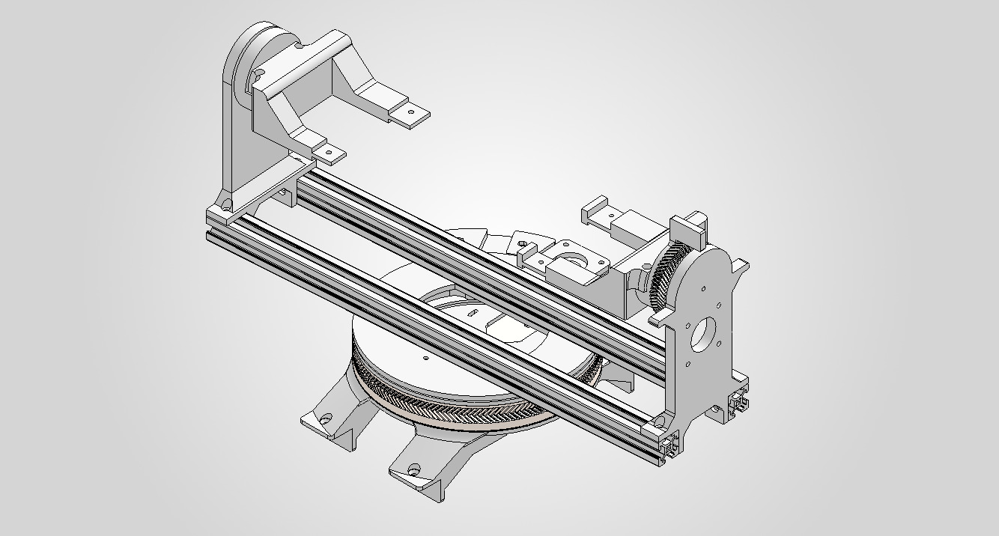
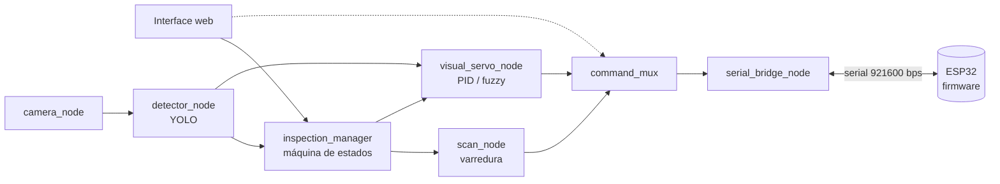

<div align="center">

# Pan-Tilt — Controle servo visual para inspeção multimodal

**Desenvolvimento de um sistema de controle servo visual baseado em mecanismo *pan-tilt* para orientação dinâmica de unidade de inspeção multimodal**

Trabalho de Conclusão de Curso · Engenharia Mecatrônica · UTFPR · 2026

<br>

<a href="https://www.utfpr.edu.br/"></a>
&nbsp;&nbsp;&nbsp;&nbsp;
<a href="#"></a>

<br><br>


<br>


<br>


</div>

---

## Sobre o projeto

A inspeção de linhas de transmissão vem migrando dos métodos manuais (observação do solo, escalada em torres) para plataformas robóticas que se deslocam sobre os condutores. Essas plataformas usam abordagens **multimodais**, que combinam câmeras, termovisores e outros sensores para identificar danos em cabos, isoladores e espaçadores.

A unidade de inspeção multimodal adotada neste trabalho fica fixada rigidamente ao corpo do robô. Com isso, o campo de visão dos sensores depende da orientação da própria plataforma, o que limita a análise aos ativos posicionados à frente dela e impede centralizar o objeto de interesse quando há oscilações ou imprecisões de posicionamento.

Este projeto propõe um **mecanismo *pan-tilt* de dois graus de liberdade** acionado por uma **malha de controle servo visual (IBVS)**. A malha usa as detecções de um modelo YOLO para buscar, selecionar e centralizar de forma autônoma o equipamento a ser inspecionado.

<div align="center">

</div>

### Objetivo geral

Desenvolver um sistema autônomo de controle servo visual, baseado em um mecanismo *pan-tilt*, para a orientação dinâmica da unidade de inspeção multimodal de equipamentos elétricos de linhas de transmissão.

### Objetivos específicos

1. Projetar um mecanismo *pan-tilt* com dois graus de liberdade que atenda às restrições geométricas e de carga útil da unidade multimodal preexistente.
2. Constituir um *dataset* especializado em equipamentos elétricos para o treinamento do modelo de detecção de objetos.
3. Implementar uma malha de controle servo visual que converta os erros de deslocamento visual em comandos de correção angular para centralizar o objeto-alvo.
4. Propor uma arquitetura de sistema que integre os módulos de percepção, controle e acionamento dos atuadores.
5. Validar o desempenho do sistema em equipamentos reais do sistema elétrico de potência.

---

## Como o sistema funciona

O operador escolhe o equipamento pela interface web. A partir daí, o sistema faz a varredura da área, seleciona a melhor detecção e centraliza o alvo no quadro de imagem:

> **IDLE** → escolha do equipamento → **filtro** na detecção → **varredura** → **seleção** do alvo (confiança × área) → **centralização** IBVS → **rastreamento** → **IDLE**



| Módulo | Descrição |
|---|---|
| **Mecânico** | Peças impressas em 3D sobre perfil de alumínio 20×20. O pan usa um rolamento impresso e engrenagens *herringbone* com redução de 17:127, e o tilt usa engrenagens com redução de 21:64. |
| **Eletrônica** | Uma ESP32, 2 drivers TMC2209 em UART, 2 motores de passo NEMA17 e 2 encoders magnéticos AS5600 lidos via multiplexador I2C PCA9548A, tudo numa PCI própria. |
| **Firmware** | Recebe comandos de velocidade e posição pela serial, devolve telemetria e tem *fail-safe* que para o mecanismo após 500 ms sem comunicação. |
| **Percepção** | YOLO (Ultralytics) treinada com 4 classes: `amortecedor_vibracao`, `esfera_sinalizacao`, `isolador_bastao` e `isolador_disco`. |
| **Controle** | Servo visual baseado em imagem (IBVS), com controladores PID e fuzzy comparados experimentalmente. |
| **Integração** | ROS 2 Humble num container Docker (Windows/WSL2) e interface web via rosbridge. |

A validação mede o **tempo de convergência** (s), o **erro residual de regime** (px) e o **erro de rastreamento** com oscilações na base (px).

---

## Estrutura do repositório

```
pantilt_tcc/
├── 01_monografia/        PDF do TCC
├── 02_software/          repositórios de código (submodules)
├── 03_pci/               esquemático e modelo 3D da placa de circuito
├── 04_mecanico/          CAD (SolidWorks), componentes comerciais, arquivos de fabricação e desenhos
└── assets/               imagens deste README
```

Padrão de nomes das pastas: `NN_minusculo_sem_acento`. A numeração das peças mecânicas está explicada em [04_mecanico/README.md](04_mecanico/README.md).

## Repositórios de software

| Repositório | Função | Branches |
|---|---|---|
| [pantilt_ros](https://github.com/WillianGiacomitti/pantilt_ros) | Nós ROS 2: percepção, controle, gerenciador e interface web | [`master`](https://github.com/WillianGiacomitti/pantilt_ros/tree/master) · [`pantilt_hardware`](https://github.com/WillianGiacomitti/pantilt_ros/tree/pantilt_hardware) · [`pantilt_perception`](https://github.com/WillianGiacomitti/pantilt_ros/tree/pantilt_perception) |
| [pantilt_firmware](https://github.com/WillianGiacomitti/pantilt_firmware) | Firmware da ESP32 (PlatformIO) | [`main`](https://github.com/WillianGiacomitti/pantilt_firmware/tree/main) · [`feat/MicroRos`](https://github.com/WillianGiacomitti/pantilt_firmware/tree/feat/MicroRos) |
| [pantilt_dockerfile](https://github.com/WillianGiacomitti/pantilt_dockerfile) | Ambiente Docker com ROS 2 Humble | [`master`](https://github.com/WillianGiacomitti/pantilt_dockerfile/tree/master) |
| [pantilt_dataset](https://github.com/WillianGiacomitti/pantilt_dataset) | Pipeline do dataset YOLO (vídeo → CVAT → YOLO → Colab) | [`main`](https://github.com/WillianGiacomitti/pantilt_dataset/tree/main) |

Os submodules apontam para a branch principal de cada repositório. A arquitetura completa (nós, tópicos, services e actions) está em [`pantilt_ros/docs/architecture.md`](https://github.com/WillianGiacomitti/pantilt_ros/blob/master/docs/architecture.md).

### Como clonar

```bash
git clone --recursive https://github.com/WillianGiacomitti/pantilt_tcc.git

# para trazer a versão mais recente de cada submodule
git submodule update --remote
```

---

## Monografia

O texto do trabalho está em [01_monografia/tcc_willian_giacomitti.pdf](01_monografia/tcc_willian_giacomitti.pdf).

## Autor

**Willian Luiz Giacomitti**
Orientador: Prof. Dr. Ronnier Frates Rohrich
Universidade Tecnológica Federal do Paraná (UTFPR)
